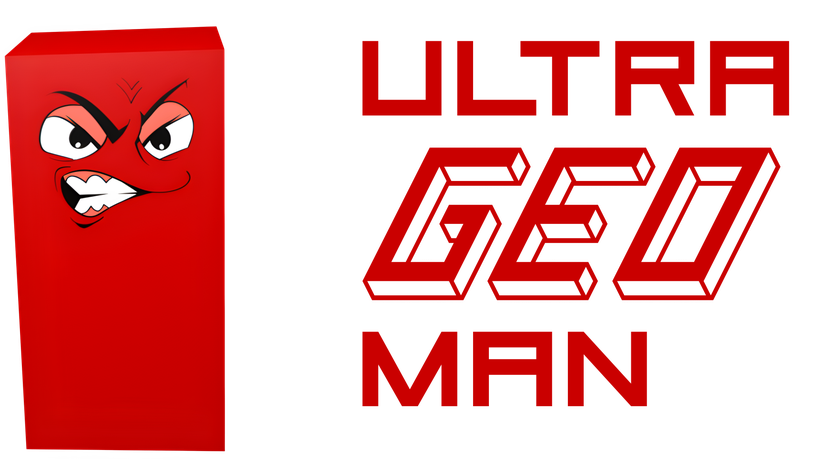
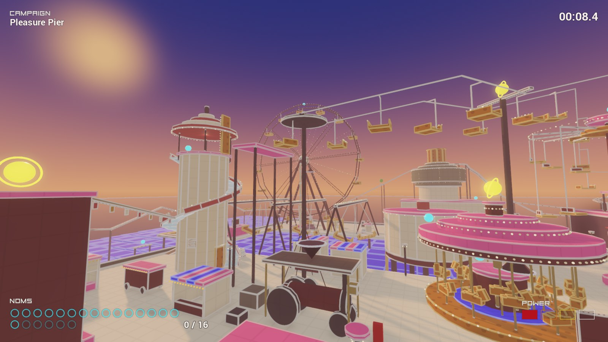
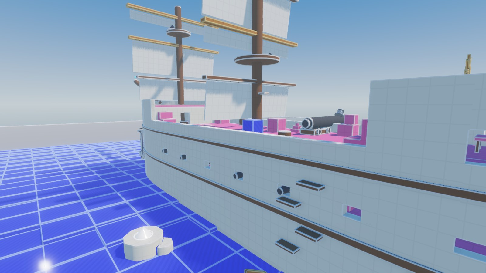
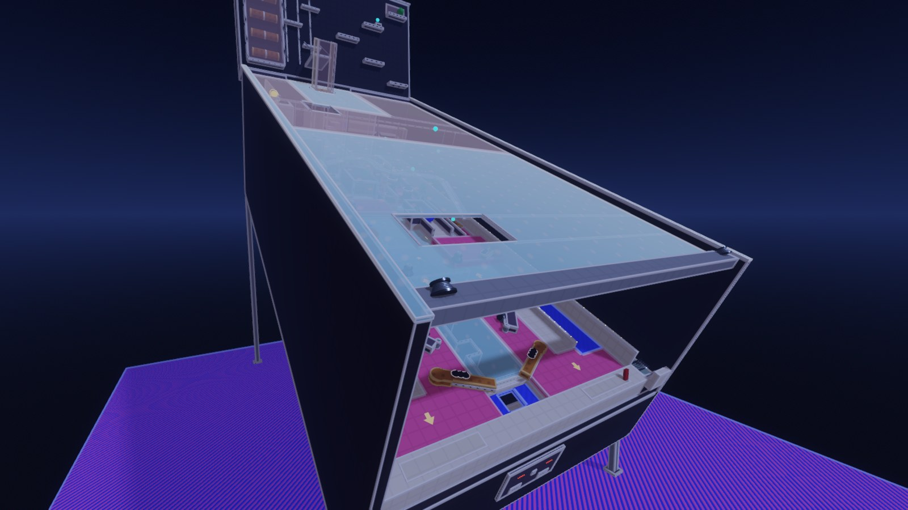
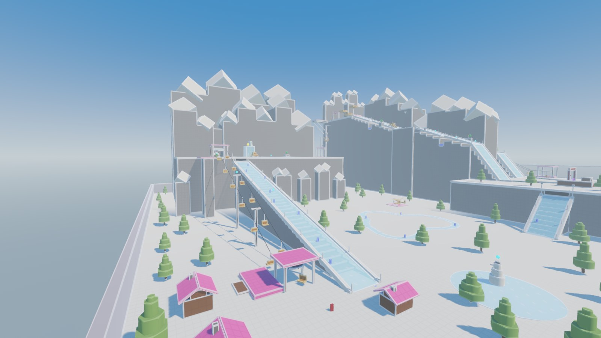

<!--
  GENERATED by release.py from release/release-README.md in the (private)
  Ultra Geoman source repository. Edit it there: a change made here is
  overwritten by the next release.
-->

<p align="center">
  
</p>

<h3 align="center">0% graphics. 100% gameplay.</h3>

<p align="center">
  A 3D platformer where colour is the whole rulebook.<br>
  Pink holds you. Blue kills you. Brown moves. Eat the noms, find the End.
</p>

<p align="center">
  <a href="https://github.com/michaeljtbrooks/ultrageoman-public/releases/latest/download/UltraGeoman-windows-x86_64.zip"></a>
  &nbsp;
  <a href="https://github.com/michaeljtbrooks/ultrageoman-public/releases/latest/download/UltraGeoman-linux-x86_64.tar.gz"></a>
</p>

<p align="center">
  <sub>
    Beta 0.1.1, released 2026-10-25
    &nbsp;·&nbsp; ARM64 (untested): <a href="https://github.com/michaeljtbrooks/ultrageoman-public/releases/latest/download/UltraGeoman-windows-arm64.zip">Windows</a>, <a href="https://github.com/michaeljtbrooks/ultrageoman-public/releases/latest/download/UltraGeoman-linux-arm64.tar.gz">Linux</a>
    &nbsp;·&nbsp; <a href="https://github.com/michaeljtbrooks/ultrageoman-public/releases">All versions</a>
    &nbsp;·&nbsp; <a href="https://github.com/michaeljtbrooks/ultrageoman-public/releases/latest/download/SHA256SUMS.txt">SHA-256 checksums</a>
  </sub>
</p>

<p align="center">
  
</p>

---

## What is it?

When I was a kid in the 90s, games were getting prettier and worse to play. Every
new console brought nicer graphics, and with them games that were linear, stuffed
with cutscenes, and dull. So a friend and I wrote a protest game in QBasic called
**SuperMega**, compiled it to an .exe and sold it on floppy disk in the school
playground. It was billed as "0% graphics, 100% gameplay".

You were a dark red rectangle. Pink platforms held you up, blue ones killed you,
brown ones moved. Green circles shot at you, yellow circles powered you up, and a
purple trapezium was the way out. I drew the levels in MS Paint: the colour of
each pixel was what it did. We knocked out over a hundred levels, and people kept
coming back for the latest disk.

**Ultra Geoman is that game, grown up into 3D.** Same rules, same colours, a lot
more to do. It's had a few lives along the way (a Darkbasic version when I was a
teenager, a browser version in 2017 written between hospital night shifts), and
this is the one that finally plays properly: rebuilt from scratch, with physics
that behave when you ride things that move, tip, swing and spin.

There's no story and no cutscenes. You turn up, you look at a level, and you work
out how to get across it.

## How it plays

Everything in the world is a coloured block, and the colour tells you what it does.
Each one has a second clue too (a pattern, a shape or a movement), so it plays fine
if you're colour-blind.

| You see | It is |
|---|---|
| Pink block | Safe to stand on |
| Pale blue, glassy | Ice. Hard to start, harder to stop |
| Blue block, striped | A trap. Touch it and you die (or lose a power level) |
| Brown block | Moves, or will when you find its switch |
| Light-blue circle | A nom. Eat enough and the End opens |
| Yellow circle | A power-up: faster, higher, and you can shoot back |
| Black cone | A switch. Swings, slides, starts or stops something, often out of sight |
| White cone | The magic switch: every pink thing turns blue and every blue thing turns pink |
| Green circle | An enemy. Shoots orange bullets at you |
| Silver coil | A spring. Land on it harder to fly higher |
| Purple trapezium | The End. An outline until you've eaten enough noms |

Power-ups turn you from red to orange, yellow and finally white. Red can't shoot.
Each step up runs faster, jumps higher and shoots further, and takes a hit for you.

The levels run from quick arcade puzzles you can finish in a minute to big worlds
you pick your way across, where one slip drops you back to the bottom. Most have a
switch puzzle at their heart, and a short cut to find for next time.

<p align="center">
  
  <br><sub><b>Pirate Ship</b>: the sea is blue, so don't fall in. Board her, fire yourself from the Long Tom and climb to the crow's nest</sub>
</p>

## The levels

The beta has nineteen levels in the campaign, roughly easiest first, plus a bonus
pack of four typed out the old way.

<table>
  <tr>
    <td width="50%"></td>
    <td width="50%"></td>
  </tr>
  <tr>
    <td align="center"><sub><b>Multiball</b>: you're the ball. Ride the flippers up the table</sub></td>
    <td align="center"><sub><b>Ski Resort</b>: chairlifts, crevasses and an avalanche you set off yourself</sub></td>
  </tr>
</table>

1. **First Steps.** Pink holds you, blue kills you, brown moves.
2. **Ice Bridge.** Hard to start, harder to stop. Mind the swinging pillars.
3. **Giant Kitchen.** You're two centimetres tall. Ride the sushi belt and let the toaster pop you up to the shelves.
4. **Polderland.** The sea has broken through the dyke. Ride a windmill's sails over the top to close the breach.
5. **Tubular Hell.** Four tubes in fog, in a different order every time.
6. **Ski Resort.** Fly off the ski jump, or set off the avalanche to bridge the great crevasse.
7. **Birchwood.** Climb the birches, hop the leaves and fell a brown tree across the gap.
8. **Ice Rink.** A frozen maze. One switch swings a third of the walls, and something lurks under the ice.
9. **Clock Tower.** Climb through the works of a great clock and catch the cuckoo when it strikes.
10. **Colosseum.** Dodge the chariots, ride the lifts up through the flooded arena and walk the velarium's rope.
11. **Building Site.** Walk up a turning mixer drum, ride a crane's girder and reach the topping-out beam 75 m up.
12. **Haunted House.** The stairs turn into a slide, the parlour tips over and the portraits watch you.
13. **Steam Railway.** The line is blue, so ride the trains: on the roof over the water troughs, down in a wagon before the tunnel.
14. **Pirate Ship.** Fire yourself from the Long Tom, ride the whale and climb to the crow's nest.
15. **Multiball.** You're the ball. Plunge, flip and slide round a giant pinball table, and run for the jackpot through multiball.
16. **Jumbo Jet.** Hitch a lift on a light aircraft, climb aboard a cargo jumbo and walk its roof to the tail.
17. **Dry Gulch.** Rob the bank through its roof, cross the gorge and ride a log down the flume.
18. **Castle Park.** Climb the tower. Switches open short-cut lifts, so a fall is never the end.
19. **Pleasure Pier.** A Victorian funfair at dusk: the gallopers, the helter skelter, the ghost train and the Ferris wheel.
20. **Via Ferrata.** Climb a misty gorge on iron rungs and rotten planks, work the winch three times and get fired across to the summit cross.

Eat every nom in a level for a nom badge. Reach the End without dying once for a
gold star, and a much bigger celebration. And every level hides a pot plant
somewhere it has no business being. It does nothing. Nobody will tell you where
they are.

## Downloads

| | Download | Then |
|---|---|---|
| **Windows** (64-bit) | [UltraGeoman-windows-x86_64.zip](https://github.com/michaeljtbrooks/ultrageoman-public/releases/latest/download/UltraGeoman-windows-x86_64.zip) | Unzip it and run `UltraGeoman.exe` |
| **Linux** (64-bit) | [UltraGeoman-linux-x86_64.tar.gz](https://github.com/michaeljtbrooks/ultrageoman-public/releases/latest/download/UltraGeoman-linux-x86_64.tar.gz) | `tar xzf UltraGeoman-linux-x86_64.tar.gz`, then `./UltraGeoman.x86_64` |
| **Steam Deck** | the Linux one, above | See below |
| Windows on ARM (untested) | [UltraGeoman-windows-arm64.zip](https://github.com/michaeljtbrooks/ultrageoman-public/releases/latest/download/UltraGeoman-windows-arm64.zip) | Unzip it and run `UltraGeoman.exe` |
| Linux on ARM (untested) | [UltraGeoman-linux-arm64.tar.gz](https://github.com/michaeljtbrooks/ultrageoman-public/releases/latest/download/UltraGeoman-linux-arm64.tar.gz) | `./UltraGeoman.arm64` |

There's no installer. Each download is one program and a short `README-FIRST.txt`.
Keep the folder wherever you like.

**Windows says "Windows protected your PC".** The game isn't code-signed yet, so
SmartScreen warns you the first time. Choose **More info**, then **Run anyway**.

**Steam Deck.** Switch to Desktop Mode, download the Linux version and extract it.
Right-click `UltraGeoman.x86_64` and choose **Add to Steam**. Back in Gaming Mode
it's in your library under **Non-Steam**, and it plays with the Deck's own controls.

**The ARM64 versions have never been run.** They're built the same way as the
others, but I don't have an ARM machine to try them on. If one works for you (or
doesn't), please say so. On Windows on ARM the ordinary Windows version also runs.

### What you need

- 64-bit Windows 10 or 11, or 64-bit Linux, or a Steam Deck
- A graphics card that can do Vulkan (or Direct3D 12 on Windows). Anything from
  the last ten years should be fine
- A keyboard and mouse, or a controller

No account, no internet connection, no telemetry. It's a game.

## Controls

| | Keyboard and mouse | Controller |
|---|---|---|
| Move | WASD or arrow keys | Left stick |
| Look | Mouse | Right stick |
| Jump (hold for higher) | Space | A |
| Shoot, once powered up | Left click, F or E | X or right trigger |
| Zoom | Mouse wheel | Shoulder buttons |
| Restart the level | R | Back / View |
| Pause | Esc or P | Start / Menu |
| Fullscreen | F11 | |

## Make your own levels

The original loaded its levels from MS Paint pictures. This one can load them from
plain text. A level pack is a single `.json` file, and a `grid` paints a level one
character per block, a layer at a time (`--- 1` starts the layer one block up).
Save this as `my_pack.json`:

```json
{
  "format": "ultrageoman-pack", "version": 1,
  "id": "my_pack", "title": "My Pack", "author": "Me",
  "levels": [
    {"id": "hop", "title": "Hop", "objects": [
      {"type": "grid", "map": [
        "--- 0",
        "#####",
        "#####",
        ".....",
        ".....",
        "##X##",
        ".....",
        ".....",
        "#####",
        "#####",
        "--- 1",
        "..E..",
        ".....",
        ".....",
        ".....",
        "o...o",
        ".....",
        ".....",
        ".....",
        "..S.."
      ]}
    ]}
  ]
}
```

`#` is a platform, `X` a trap, `o` a nom, `E` the End and `S` where you start. There's
also `~` ice, `=` a mover, `*` a power-up, `^` a switch, `!` the magic switch, `G` an
enemy and `Z` a spring.

Put packs in a folder called `levelpacks` next to the game, or in the folder that
**Levels > Open level-pack folder** opens, and press **Reload packs**.

## The beta

This is a beta, so expect bugs: a ledge you can't quite reach, a switch that does
something odd, a way round a puzzle I didn't intend. Please
[open an issue](https://github.com/michaeljtbrooks/ultrageoman-public/issues) and say which level, roughly
where, and what happened. A screenshot helps a lot.

Progress is saved as you go, and carries over to new versions:

- Windows: `%APPDATA%\Godot\app_userdata\Ultra Geoman`
- Linux and Steam Deck: `~/.local/share/godot/app_userdata/Ultra Geoman`

## Credits

Ultra Geoman is © 2026 Dr Michael Brooks. All rights reserved. The source code
isn't public. Built with the [Godot Engine](https://godotengine.org) (MIT licence)
and its Jolt physics. Text is set in Roboto and Aerial. The licences come with each
download, in `godot-COPYRIGHT.txt` and `THIRD-PARTY-NOTICES.txt`.
